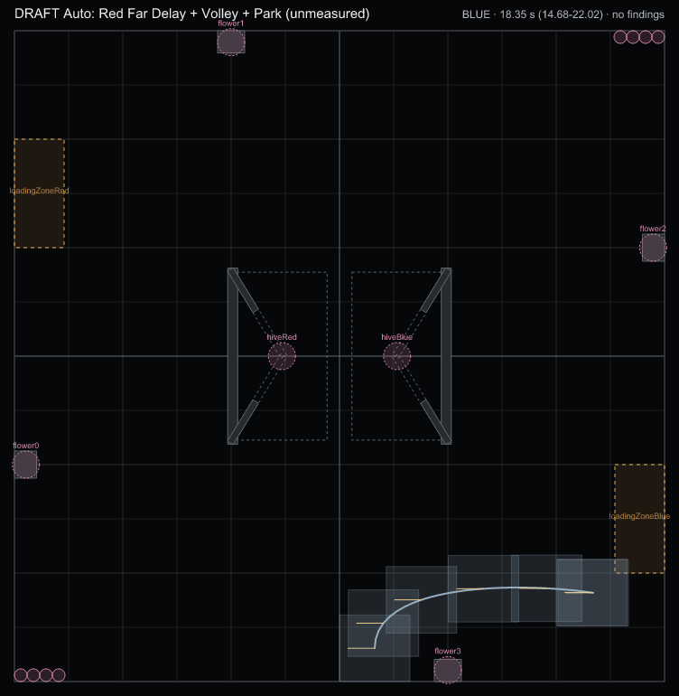
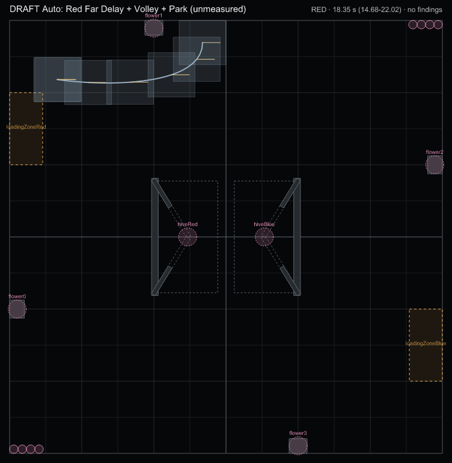

# Review: Blue Audience Delay + Volley + Park

Written 2026-11-21 for a teammate to review.

**Status:** draft, never run on the robot. It is already in `V1.0.1`: the first commit went in through PR #7, and a follow-up commit (`c3c8374`) went in directly without a PR, so that second change has not had a review yet.

## What it does

It is authored once as `red-far-volley-park` in the red frame. The blue wrapper runs it point-mirrored, and the red file gets its own generated entry.

| Driver Station name | Group |
| --- | --- |
| **DRAFT Auto: Blue Audience Delay + Volley + Park** | Competition (preselects the Blue TeleOp) |
| DRAFT Auto: Red Far Delay + Volley + Park (unmeasured) | Generated |

1. **Start:** left side on the wall, front exactly on the centre line, facing toward it. Blue pose is (7.796, -64.638, 180 deg); the red file has (-7.796, 64.638, 0 deg).
2. **Pre-aim** at the far cell (blue: audience cell) with the flywheel spinning, and stow the depollinator.
3. **Wait 10 s** (this is the partner's window to tip the hive).
4. **`volley`:** 2.5 s continuous feed, 3 s ready timeout, `FIRE` fallback, flywheel off after. The range to the cell is about 50.0 in, inside the measured 12-60 in table (about 3200 RPM).
5. **Park:** a curved path at 0.35 speed to (56.2, -52.36) blue, with the heading held constant at 180 deg. Then `stopAll`.

The estimate is 18.35 s nominal (14.7-22.0 s) against the 29 s limit.

## What it looks like

Zenith's own render of the plan (`zenith render`), field from above with the audience wall at the bottom. The boxes are the robot footprint along the route; the start box has its front edge on the centre line.

**Blue (the Competition entry):**

**Red (the Generated entry, same route mirrored):**

Both report 18.35 s and no findings. This is the ideal plan, not the real robot's motion.

## What changed

- **First commit (#7):** the routine, the blue wrapper, the generated red stub, and a doc section.
- **Follow-up (`c3c8374`):**
  - The start x moved from -9.2 to **-7.796**, so the front is exactly on the line, with the first park control point at the same x.
  - **`robot.json` `expandedIn` length went from 18 in to 15.591 in.**
  - Docs updated.

## Geometry checked

- **Walls:** the park leaves the chassis 8.0 in from the red wall and 12.3 in from the far wall, so nothing touches.
- **Loading zone:** only a 3.00 x 3.00 in square of the rear-right corner overlaps the zone.
- **Validation:** Zenith validation reports 0 errors, and all 349 unit tests pass.

## Please look at these

1. **The shared footprint change.** Zenith checks every step against one box with no per-routine override, so the exact-line start only validates if that box is not longer than the chassis. The side effect: `red-audience`, `red-far` and `red-far-cycle`, which do deploy the depollinator, are now checked against a box 2.4 in shorter than before. The measured depollinator-down length (537 mm) is still not applied.
2. **`FIRE` after 3 s.** If the shot is not ready in time it feeds anyway, without readiness (turret homed only). Is that what we want in a match, or should it be `SKIP`?
3. **Backing up.** The park drives **backward** with the heading held. Fine once the volley has emptied the preload, but please confirm for this chassis.
4. **Thin park margin.** There is only 3.0 in of margin to the zone edge on each axis. Landing 3 in short in either direction gives no zone overlap at all. The zone bounds are marked APPROX in the field file, so check the spot on the real field.
5. **Scoring.** Solo, this alliance's far cell (blue: audience cell) starts lowered. The volley scores only if a partner tips the hive during the 10 s delay.
6. **Assumptions to confirm:** the Pinpoint tracking point is the chassis centre (unconfirmed), and the zone square stays about 3 x 3 in.
7. **The gate.** `TUNING_VERIFIED` is now `true`, but the tuning checklist was never filled in.

## To try it safely

1. Do a bench run first, with the robot on blocks. Paths will time out.
2. Run **TEST: Volley from the wall start** to check the volley on its own.
3. For the first floor run, cut `speedFraction` on the park path, use a cleared area, and keep someone on STOP.
